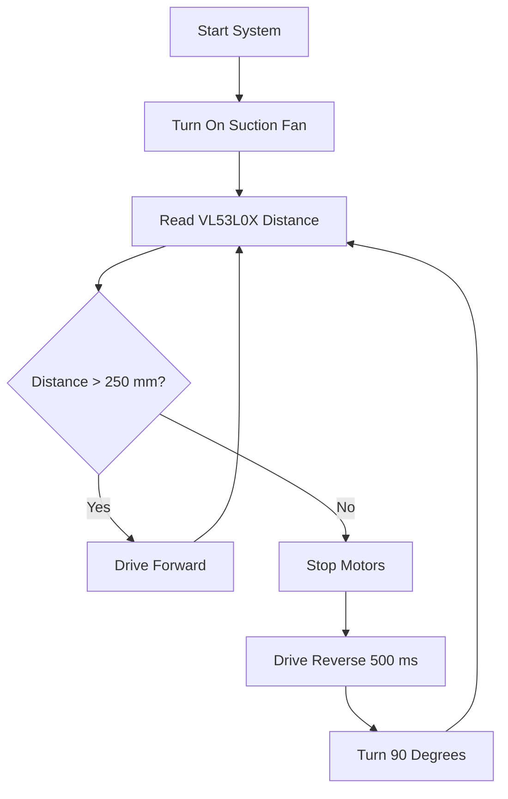

# Cleo - Minimum Viable Product (MVP) Plan

This document defines the basic requirements for the Cleo autonomous vacuum prototype.

## 1. System Goal

The robot must move across a room, avoid obstacles, and collect loose debris.

## 2. Hardware List

| Component | Part Name / Type | Function |
| :--- | :--- | :--- |
| Microcontroller | Arduino Uno Q | Main controller and logic execution |
| Primary Sensor | GY-53 VL53L0X | Long-range obstacle detection (ToF) |
| Secondary Sensors | Laboratory IR modules | Cliff detection or side obstacle detection |
| Drive Motors | 2x Yellow TT DC gear motors (3V-6V) | Wheel drive system |
| Support Wheel | 1x Caster wheel | Balance support |
| Motor Driver | Dual H-bridge (TB6612FNG or L298N) | Motor direction and speed control |
| Cleaning Fan | 5V DC centrifugal blower fan (5015) | Air suction and dust collection |
| Power Source | Single 5V USB power bank or battery | Unified power supply |

## 3. Sensor Configuration

### GY-53 VL53L0X
- **Position:** Front center of the robot frame.
- **Connection:** I2C bus (SDA, SCL, 3.3V or 5V, GND).
- **Operation:**
  - Measures the distance to objects directly in front.
  - Operational range: 30 mm to 1200 mm.

### Laboratory IR Sensors (Optional)
- **Position:** Front edges pointing down, or front corners pointing outward.
- **Connection:** Digital input pins.
- **Operation:**
  - Cliff detection: Detects when the floor surface disappears.
  - Corner detection: Detects obstacles outside the field of view of the ToF sensor.

## 4. Control Logic

1. Turn on the suction fan.
2. Read the front distance value from the VL53L0X sensor.
3. If the distance is more than 250 mm:
   - Command both drive motors forward.
4. If the distance is equal to or less than 250 mm:
   - Stop both drive motors.
   - Command both drive motors in reverse for 500 milliseconds.
   - Turn the robot 90 degrees to clear the obstacle.
5. Return to step 2 and repeat continuously.

## 5. Development Steps

1. **Step 1:** Verify the GY-53 VL53L0X sensor reading on the Arduino Uno Q.
2. **Step 2:** Test motor control using the motor driver board.
3. **Step 3:** Combine sensor data with motor control logic.
4. **Step 4:** Mount all hardware onto the chassis and connect the suction fan.
5. **Step 5:** Complete autonomous test runs in an enclosed area.
